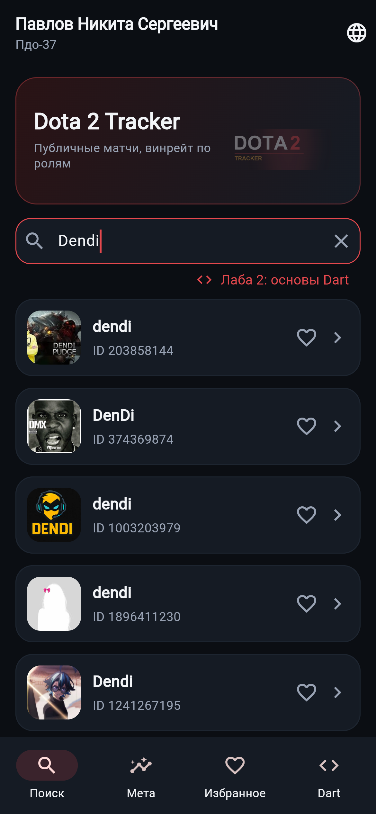
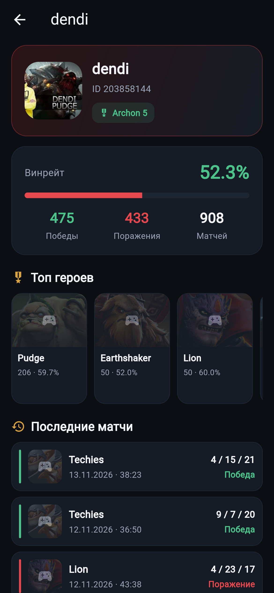
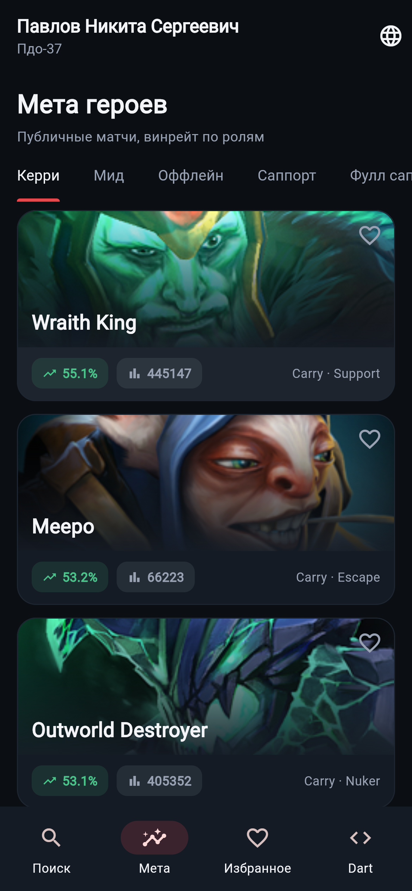

# Dota 2 Tracker

Учебное Flutter-приложение по лабораторным работам: поиск игроков Dota 2, профиль, мета героев по ролям и избранное.

**Студент:** Павлов Никита Сергеевич  
**Группа:** Пдо-37  
**Данные:** [OpenDota API](https://api.opendota.com/api)

## Быстрый запуск

```bash
flutter pub get
flutter run
```

Подробная инструкция — в файле [КАК_ЗАПУСТИТЬ.md](КАК_ЗАПУСТИТЬ.md).

## Что умеет

- поиск игрока по нику или Steam ID;
- профиль: аватар, ранг, винрейт, последние матчи, топ героев;
- мета героев с вкладками Carry, Mid, Offlane, Support, Hard Support;
- детальная страница героя;
- лайки игроков и героев с сохранением на устройстве;
- русская и английская локализация;
- тёмная тема.

## Скриншоты

| Поиск | Профиль | Мета героев |
|---|---|---|
|  |  |  |

## Лабораторные

| Лаба | Что сделано | Где смотреть |
|---|---|---|
| 1 | Flutter-проект, Android, AppBar с ФИО и группой | `lib/presentation/screens/home_shell.dart` |
| 2 | Классы, enum, циклы, generics, анонимные функции, Future, extension | `lib/presentation/screens/dart_basics_screen.dart` |
| 3 | Список карточек с текстом и картинками | `lib/presentation/widgets/hero_card.dart` |
| 4 | Лайк, SnackBar, детальный экран | `lib/presentation/screens/hero_detail_screen.dart` |
| 5 | OpenDota API, DTO, интерфейсы, репозитории | `lib/data/`, `lib/domain/` |
| 6 | BLoC, debounce 500 мс, pull-to-refresh | `lib/presentation/bloc/` |
| 7 | Иконка, RU/EN ARB, SharedPreferences | `assets/icon/`, `lib/l10n/`, `lib/data/repositories/likes_repository_impl.dart` |

Приложение не связано с Valve. Все данные предоставляет OpenDota.
